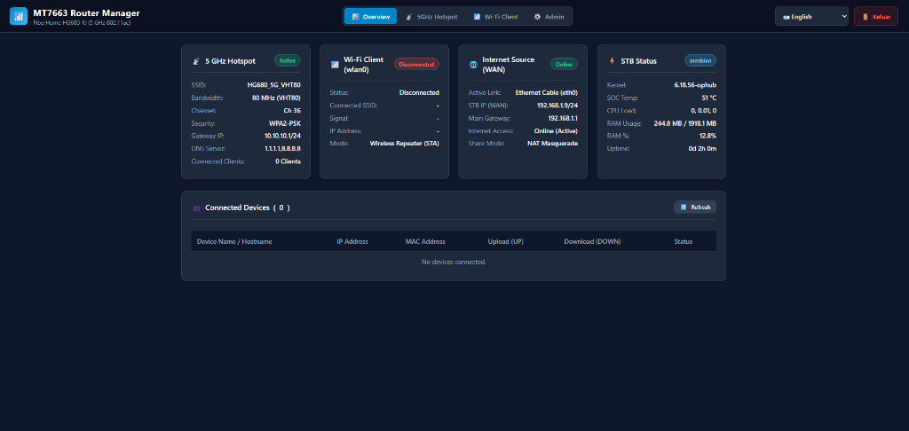
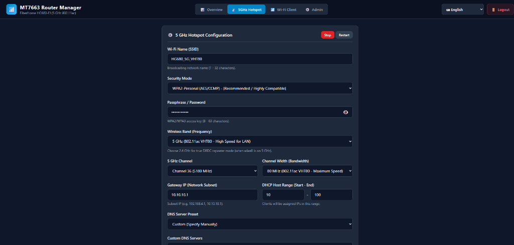
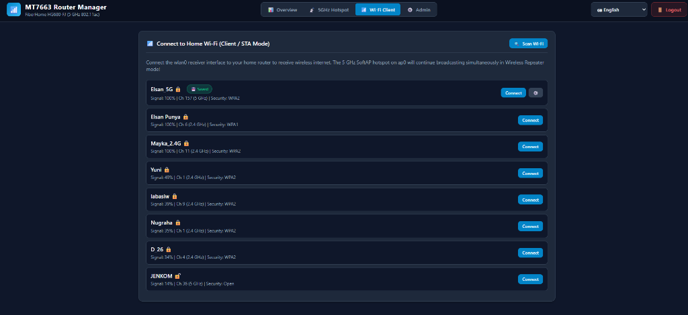
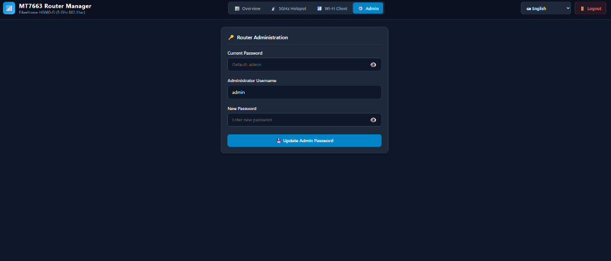

<p align="right">
  <a href="README.md">English</a> | <b>Bahasa Indonesia</b>
</p>

# MT7663 Router Web UI & Turnkey SoftAP Hotspot (Panduan Bahasa Indonesia)

[](https://github.com/elsangithub/mt7663-router-webui/releases)
[](https://github.com/elsangithub/mt7663-router-webui/actions)
[-orange.svg)]()
[-blue.svg)]()
[-red.svg)]()
[](LICENSE)

Dashboard web manajemen router WSGI yang sangat ringan (tanpa dependensi berat) dan pengendali SoftAP hotspot terintegrasi khusus untuk modul Wi-Fi **MediaTek MT7663** SDIO pada STB **FiberHome HG680-FJ** (Amlogic S905X2 / Meson G12A) dengan sistem operasi Armbian Linux.

Paket ini mengubah STB Anda menjadi **Router Wi-Fi Mandiri & Wireless Repeater DBDC** dengan dukungan pergantian otomatis sumber WAN via **Kabel LAN (`eth0`)** maupun **Wi-Fi Klien (`wlan0`)**, tanpa membutuhkan dongle Wi-Fi USB tambahan.

---

### 🧪 Lingkungan Pengujian Resmi
* **Perangkat Target**: FiberHome HG680-FJ (Amlogic S905X2 / Meson G12A)
* **Modul Wi-Fi**: MediaTek MT7663 / MT7661 SDIO (`037A:7663`)
* **Sistem Operasi**: Armbian v26.11.0 for Aml.S905x2 (Linux kernel `6.18.56-ophub`)
* **Basis Paket**: Debian stable (Bookworm 12)

---

## 📸 Tangkapan Layar Tampilan Web Dashboard

<div align="center">

### 1. Ringkasan Sistem & Telemetri Live (Overview)


<br>

| 📡 Setelan Hotspot (2.4 / 5 GHz) | 📶 Pemindai Wi-Fi Rumah (Client Mode) |
| :---: | :---: |
|  |  |

<br>

### 4. Administrasi & Keamanan Router


</div>

---

## 🌟 Fitur Utama

* **Multi-Sumber WAN (Kabel Ethernet & Repeater Nirkabel)**:
  * **Mode Access Point Kabel (WAN `eth0`)**: Cukup colok kabel LAN dari modem ISP ke STB, dan STB akan memancarkan hotspot 5 GHz super cepat (VHT80 866 Mbps) atau 2.4 GHz.
  * **Mode Repeater Nirkabel (WAN `wlan0`)**: Menangkap sinyal Wi-Fi rumah secara nirkabel pada `wlan0` dan secara simultan memancarkan hotspot terisolasi pada `ap0`.
* **Dashboard WSGI Tanpa Dependensi Berat (Zero-Dependency)**:
  * Dibangun dengan Python 3 murni menggunakan micro-framework bawaan (`bottle.py`). Tidak membutuhkan Node.js, npm, ataupun web server berat.
  * Penggunaan RAM sangat hemat: **di bawah 25 MB**, sangat cocok untuk STB TV box minimalis.
* **Bilingual Penuh (Bahasa Indonesia & English)**:
  * Tombol alih bahasa instan dengan satu klik (**ID / EN**) pada bilah navigasi.
  * Seluruh menu drop-down, label statistik, daftar kanal, opsi keamanan, hingga modal dialog diterjemahkan secara rapi dan menyeluruh.
* **Stack Hotspot Terisolasi & Aman**:
  * Menjalankan daemon `hostapd` dan `dnsmasq` mandiri yang khusus mengikat pada interface `ap0` (`10.10.10.1/24`).
  * Service global Debian secara otomatis di-mask agar tidak terjadi bentrok port 53 (DNS) maupun port 67 (DHCP) dengan upstream.
* **Telemetri Suhu & Pemantauan Perangkat Live**:
  * Pemantauan suhu SoC Amlogic secara langsung dari sensor kernel (`/sys/class/thermal/thermal_zone0/temp`).
  * Tabel perangkat terhubung secara *real-time*: menampilkan MAC address, IP sewa DHCP, nama perangkat (hostname), nama alias custom, serta bandwidth unduh (DOWN) dan unggah (UP) per perangkat.
* **Otomasi Routing & NAT Masquerade**:
  * Skrip NetworkManager dispatcher (`90-wlan0-routing.sh`) otomatis menyetel aturan iptables NAT setiap kali antarmuka internet (`wlan0` atau `eth0`) terhubung.
  * Optimasi parameter kernel sysctl untuk *IP Forwarding* dan isolasi ARP (`arp_ignore=1`, `arp_announce=2`).

---

## 📐 Arsitektur Jaringan

```
       [ Sumber WAN 1: Kabel LAN ]           [ Sumber WAN 2: Wi-Fi Rumah ]
       Router / Modem Rumah (eth0)           Wi-Fi 2.4 / 5 GHz (wlan0)
                   │                                     │
                   └─────────────────┬───────────────────┘
                                     ▼
                   +─────────────────────────────────────+
                   |  FiberHome HG680-FJ (Amlogic S905X2)|
                   |                                     |
                   |      Auto-Detect WAN Interface      |
                   |      (NetworkManager Dispatcher)    |
                   |                 │                   |
                   |        iptables NAT / Masquerade    |
                   |        IPv4 IP Forwarding = 1       |
                   |        Isolated dnsmasq (DHCP/DNS)  |
                   |                 │                   |
                   |  Dual-Band Hotspot Engine (ap0)     |
                   |  2.4 GHz (HT40) / 5 GHz (VHT80 866M)|
                   |                 │                   |
                   |   WSGI Management Web UI (:8080)    |
                   +─────────────────┬───────────────────+
                                     │
                                     ▼ Pancaran Hotspot
                        [ HP / Laptop / Smart TV ]
```

---

## ⚡ Lebar Pita 80 MHz (VHT80): Kemampuan & Konsekuensi / Risikonya

Chipset MT7663 mendukung protokol **802.11ac Wave 2 VHT80** (lebar pita 80 MHz). Memahami keunggulan dan karakteristiknya sangat penting untuk mendapatkan performa terbaik:

### 🚀 Kemampuan & Keunggulan:
* **Kecepatan Link 866 Mbps**: Pada lebar pita 80 MHz dengan 2x2 MU-MIMO di 5 GHz, perangkat klien yang kompatibel dapat mencapai kecepatan tautan (*link rate*) hingga 866.7 Mbps.
* **Throughput Nyata Super Cepat**: Mencapai kecepatan throughput riil **350–500 Mbps** pada pengujian iperf3 maupun internet. Sangat ideal untuk streaming 4K tanpa buffering, transfer file lokal LAN yang masif, dan gaming rendah latensi.
* **Sangat Maksimal dengan Sumber `eth0`**: Jika internet masuk melalui kabel LAN (`eth0`), modul radio MT7663 dapat mendedikasikan 100% daya pancar radionya pada `ap0` di 80 MHz tanpa terganggu aktivitas penerimaan nirkabel lain.

### ⚠️ Risiko & Konsekuensi Lingkungan:
* **Daya Tembus Dinding Lebih Rendah**: Frekuensi tinggi 5 GHz 80 MHz secara alami mengalami pelemahan (*attenuation*) sinyal yang lebih besar saat menembus dinding semen dan cor beton dibanding 2.4 GHz.
* **Kepadatan Spektrum (*Interferensi*)**: Lebar pita 80 MHz menggabungkan 4 kanal 20 MHz sekaligus (misal 36 + 40 + 44 + 48). Di lingkungan padat penduduk dengan banyak router tetangga, potensi tabrakan kanal lebih tinggi.
* **Risiko pada Mode Repeater 5G ke 5G**: Jika Anda menggunakan `wlan0` untuk menangkap Wi-Fi 5 GHz dan sekaligus memancarkan `ap0` di 5 GHz 80 MHz, radio tunggal harus melakukan *time-slicing* frekuensi yang sangat ketat, yang pada beban berat dapat memicu penumpukan antrean buffer.  
  * **Solusi**: Untuk mode repeater nirkabel murni, atur `wlan0` di 5 GHz dan `ap0` di **2.4 GHz (HT40)**, atau sebaliknya (DBDC Sejati).

---

## 📋 Syarat Sistem

Sebelum memasang paket Web UI ini, pastikan paket driver murni DKMS telah terpasang:

1. **Driver Kernel**: [`mt7663-dkms`](https://github.com/elsangithub/mt7663-driver) (versi **1.0.11** atau lebih baru).
2. **Sistem Operasi**: Armbian Linux (`6.18.59-ophub` / basis Debian 12/13).

---

## 🚀 Panduan Instalasi

### 1. Pasang via Perintah APT

Unduh paket rilis `.deb` terbaru dan pasang menggunakan `apt` agar seluruh dependensi pendukung (`hostapd`, `dnsmasq`, `python3`, `iptables`, `wireless-tools`) diunduh dan dipasang secara otomatis:

```bash
# Unduh paket rilis terbaru (v1.0.5)
wget https://github.com/elsangithub/mt7663-router-webui/releases/download/v1.0.5/mt7663-router-webui_1.0.5_all.deb

# Pasang paket dan selesaikan dependensi otomatis
sudo apt update
sudo apt install ./mt7663-router-webui_1.0.5_all.deb
```

### 2. Aktifkan Mode Dual AP/STA

Pada instalasi pertama kali, lakukan reboot pada STB agar kontroler bus SDIO Amlogic melakukan reset daya fisik bersih dan membaca parameter `ap_mode=1`:

```bash
sudo reboot
```

Setelah menyala kembali, pastikan kedua antarmuka nirkabel sudah aktif:
```bash
ip link show wlan0
ip link show ap0
```

---

## 🖥️ Cara Mengakses Web Dashboard

1. Hubungkan HP atau laptop Anda ke hotspot Wi-Fi bawaan STB:
   * **Nama SSID**: `MT7663-Hotspot` (atau `HG680_5G_VHT80`)
   * **Kata Sandi**: `password123`
2. Buka browser dan kunjungi alamat:
   * **URL**: [`http://10.10.10.1:8080`](http://10.10.10.1:8080)
   * *(Atau bisa diakses via IP LAN kabel Ethernet STB Anda di `http://<IP-LAN-STB>:8080`)*
3. Masuk menggunakan akun administrator bawaan:
   * **Username**: `admin`
   * **Password**: `admin`

> [!TIP]
> Anda dapat mengganti username dan password admin kapan saja melalui tab **Admin**.

---

## ⚙️ Berkas Konfigurasi Sistem

Paket ini menempatkan konfigurasinya pada struktur berkas standar Linux:

| Jalur Berkas | Fungsi & Keterangan |
| :--- | :--- |
| `/etc/default/mt7663-hotspot` | Setelan lingkungan hotspot (SSID, kanal, frekuensi band, IP gateway, rentang DHCP, server DNS). |
| `/etc/hostapd/hostapd-mt7663.conf` | Templat konfigurasi runtime hostapd yang digenerate otomatis oleh service hotspot. |
| `/etc/modprobe.d/wlan_mt7663_sdio.conf` | Opsi modul kernel pengaktif `ap_mode=1` untuk pembuatan antarmuka ganda. |
| `/etc/sysctl.d/99-mt7663.conf` | Parameter kernel untuk IPv4 forwarding dan isolasi ARP. |
| `/etc/NetworkManager/dispatcher.d/90-wlan0-routing.sh` | Skrip hook otomatis yang mengatur iptables NAT setiap kali koneksi WAN menyala. |
| `/etc/mt7663-device-names.json` | Menyimpan nama alias custom yang Anda berikan ke perangkat klien di Web UI. |

---

## 🗑️ Cara Menghapus Paket (Uninstall)

Jika suatu saat Anda ingin mencopot paket Web UI dan mengembalikan STB menjadi klien Wi-Fi biasa (`wlan0` saja):

```bash
# 1. Hapus paket Web UI dan konfigurasinya
sudo apt purge -y mt7663-router-webui

# 2. Bersihkan dependensi yang tidak terpakai lagi
sudo apt autoremove -y --purge

# 3. Reboot untuk memulihkan mode murni wlan0
sudo reboot
```

---

## 📄 Lisensi

Proyek ini dilisensikan di bawah lisensi **GNU General Public License v2.0 (GPLv2)**.
