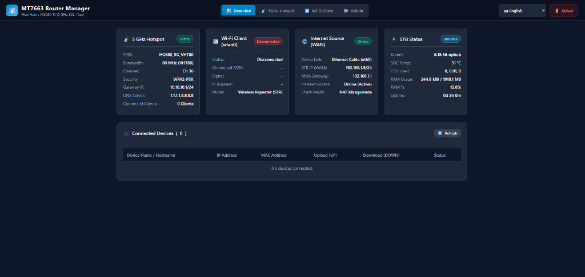
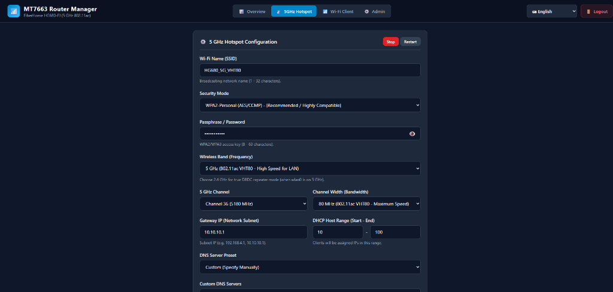
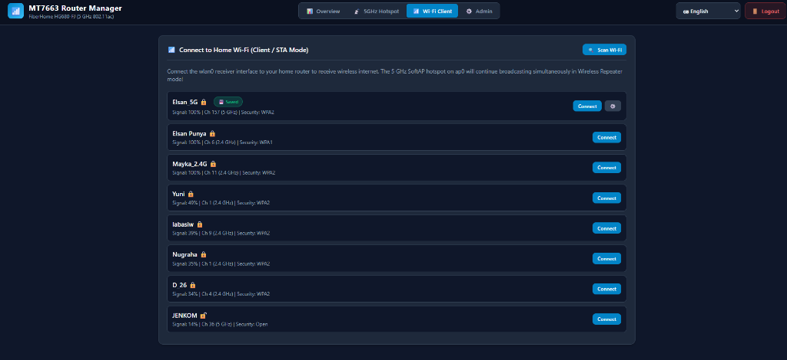
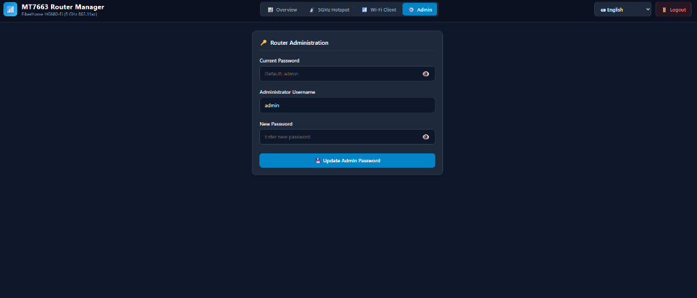

<p align="right">
  <b>English</b> | <a href="README.id.md">Bahasa Indonesia</a>
</p>

# MT7663 / MT7668 Router Web UI & Turnkey SoftAP Hotspot

[](https://github.com/elsangithub/mt7663-router-webui/releases)
[](https://github.com/elsangithub/mt7663-router-webui/actions)
[-orange.svg)]()
[-blue.svg)]()
[]()
[](LICENSE)

A lightweight, zero-dependency WSGI management dashboard and turnkey SoftAP hotspot controller designed for MediaTek **MT7663** and **MT7668** SDIO Wi-Fi modules on the **FiberHome HG680-FJ** (Amlogic S905X2 / Meson G12A) running Armbian Linux.

This package transforms your TV box into a standalone **Dual-Band Wireless Router & DBDC Repeater** with auto-switching upstream WAN support via **Ethernet (`eth0`)** or **Wi-Fi Client (`wlan0`)**, requiring no external USB Wi-Fi dongles.

---

### 🧪 Verified Test Environment & Driver Repositories
* **Target Hardware**: FiberHome HG680-FJ (Amlogic S905X2 / Meson G12A)
* **Supported Wi-Fi Modules & Companion Driver Repositories**:
  * **MediaTek MT7663 / MT7661 SDIO** (`037A:7663`): [`elsangithub/mt7663-driver`](https://github.com/elsangithub/mt7663-driver)
  * **MediaTek MT7668 SDIO** (`037A:7668` / `0x7608` / `0x6602`): [`elsangithub/mt7668-driver`](https://github.com/elsangithub/mt7668-driver)
* **Operating System**: Armbian Linux (`6.18.56-ophub` / `6.18.59-ophub`)
* **Userspace / Packages**: Debian stable (Bookworm 12 / Trixie 13)

---

## 📸 Dashboard Previews

<div align="center">

### 1. Overview & Live Hardware Telemetry


<br>

| 📡 5 GHz / 2.4 GHz SoftAP Configuration | 📶 Wi-Fi Client Scanner (STA Mode) |
| :---: | :---: |
|  |  |

<br>

### 4. Router Administration & Security


</div>

---

## 🌟 Key Features

* **Multi-Source WAN (Ethernet & Wireless Repeater)**:
  * **Ethernet Access Point Mode (`eth0` WAN)**: Plugs directly into your main ISP modem/router via LAN cable and broadcasts ultra-fast 5 GHz (VHT80 866 Mbps) or 2.4 GHz wireless.
  * **DBDC Wireless Repeater Mode (`wlan0` WAN)**: Receives home Wi-Fi wirelessly on `wlan0` while simultaneously re-broadcasting an isolated hotspot on `ap0`.
* **Zero-Dependency WSGI Dashboard**:
  * Written in pure Python 3 using an embedded micro-framework (`bottle.py`). No Node.js, npm, or heavy web server runtimes required.
  * Consumes under **25 MB RAM**, ideal for minimal TV box environments.
* **Full Bilingual Support (English & Bahasa Indonesia)**:
  * Instant, one-click language toggle (**ID / EN**) in the navigation bar.
  * Every dropdown menu, status badge, channel list, and security parameter is fully localized.
* **Isolated Hotspot Stack**:
  * Dedicated `hostapd` and `dnsmasq` instances specifically bound to `ap0` (`10.10.10.1/24`).
  * System-wide daemons are safely masked to prevent port 53/67 binding conflicts with upstream DNS resolvers.
* **Live Hardware & Traffic Telemetry**:
  * Real-time SoC temperature monitoring from Amlogic thermal zones (`/sys/class/thermal/thermal_zone0/temp`).
  * Live client device table displaying MAC, assigned IP, hostname, custom device alias, and real-time per-client upload/download bandwidth.
* **Automated NAT & Routing Dispatcher**:
  * Automatic `iptables` NAT masquerade triggered via NetworkManager dispatcher whenever `wlan0` or `eth0` goes UP.
  * Sysctl kernel optimizations for IPv4 forwarding and ARP isolation (`arp_ignore=1`, `arp_announce=2`).

---

## 📐 Network Architecture

```
       [ WAN Source 1: Wired LAN ]           [ WAN Source 2: Home Wi-Fi ]
       Main Modem / Router (eth0)             Home Wi-Fi 2.4 / 5G (wlan0)
                   │                                     │
                   └─────────────────┬───────────────────┘
                                     ▼
                   +─────────────────────────────────────+
                   |  FiberHome HG680-FJ (Amlogic S905X2)|
                   |                                     |
                   |      Auto-Detect WAN Interface      |
                   |      (NetworkManager Dispatcher)    |
                   |                 │                   |
                   |        iptables NAT / Masquerade    |
                   |        IPv4 IP Forwarding = 1       |
                   |        Isolated dnsmasq (DHCP/DNS)  |
                   |                 │                   |
                   |  Dual-Band Hotspot Engine (ap0)     |
                   |  2.4 GHz (HT40) / 5 GHz (VHT80 866M)|
                   |                 │                   |
                   |   WSGI Management Web UI (:8080)    |
                   +─────────────────┬───────────────────+
                                     │
                                     ▼ SoftAP Broadcast
                        [ Phones / Laptops / Smart TVs ]
```

---

## ⚡ 80 MHz Channel Width (VHT80): Capabilities & Trade-Offs

The MediaTek MT7663 and MT7668 chipsets support **802.11ac Wave 2 VHT80** (80 MHz bandwidth). Understanding their capabilities and environmental trade-offs helps you achieve the best performance:

### 🚀 Capabilities:
* **866 Mbps Physical Link Rate**: When operating at 80 MHz with 2x2 MU-MIMO on 5 GHz, compatible client devices achieve theoretical link speeds of up to 866.7 Mbps.
* **Real-World High Throughput**: Achieves **350–500 Mbps** actual throughput in iperf3/speed tests. Ideal for 4K video streaming, high-speed local NAS transfers, and low-latency gaming.
* **Peak Performance with `eth0` WAN**: Using `eth0` as the wired WAN input allows the MediaTek radio (MT7663 / MT7668) to dedicate 100% of its RF airtime to client devices on `ap0` at full 80 MHz speeds.

### ⚠️ Environmental Risks & Caveats:
* **Reduced Wall Penetration**: High-frequency 5 GHz signals naturally experience higher attenuation through solid walls and concrete compared to 2.4 GHz.
* **RF Spectrum Congestion**: An 80 MHz channel bonds 4 contiguous 20 MHz channels (e.g. 36 + 40 + 44 + 48). In densely populated apartment complexes with many nearby 5 GHz routers, channel collisions may trigger packet retries.
* **Repeater Mode Caveat (5 GHz STA + 5 GHz AP)**: If you use `wlan0` to receive a 5 GHz network and simultaneously run `ap0` at 5 GHz 80 MHz, the single physical radio must rapidly time-slice between listening and transmitting. Under extreme workloads, this may lead to buffer overflow.  
  * **Solution**: For wireless repeater mode, configure `wlan0` on 5 GHz and `ap0` on **2.4 GHz (HT40)**, or vice versa (True DBDC).

---

## 📋 Prerequisites

Before installing this package, ensure you have installed the matching DKMS driver:

1. **Kernel Driver**:
   * For MT7663: [`mt7663-dkms`](https://github.com/elsangithub/mt7663-driver) (>= **1.0.11**)
   * For MT7668: [`mt7668-dkms`](https://github.com/elsangithub/mt7668-driver) (>= **2.0.1**)
2. **Operating System**: Armbian Linux (`6.18.59-ophub` / Debian 12/13 base).

---

## 🚀 Installation

### 1. Install via APT

Download the latest `.deb` release package and install it using `apt` so that all required runtime dependencies (`hostapd`, `dnsmasq`, `python3`, `iptables`, `wireless-tools`) are automatically resolved:

```bash
# Download latest release package (v1.0.6)
wget https://github.com/elsangithub/mt7663-router-webui/releases/download/v1.0.6/mt7663-router-webui_1.0.6_all.deb

# Install and automatically resolve dependencies
sudo apt update
sudo apt install ./mt7663-router-webui_1.0.6_all.deb
```

### 2. Activate Dual AP/STA Mode

On the first installation, reboot your STB to allow the Amlogic SDIO bus controller to perform a clean hardware reset with `ap_mode=1`:

```bash
sudo reboot
```

After reboot, verify both interfaces are present:
```bash
ip link show wlan0
ip link show ap0
```

---

## 🖥️ Accessing the Web Dashboard

1. Connect your phone or laptop to the default Wi-Fi hotspot:
   * **SSID**: `HG680_5G_VHT80` (or custom configured SSID)
   * **Password**: `password123`
2. Open your web browser and navigate to:
   * **URL**: [`http://10.10.10.1:8080`](http://10.10.10.1:8080)
   * *(Alternatively, access via your STB's Ethernet IP at `http://<STB-LAN-IP>:8080`)*
3. Log in with the default administrator credentials:
   * **Username**: `admin`
   * **Password**: `admin`

> [!TIP]
> You can change the admin username and password anytime in the **Admin** tab.

---

## ⚙️ Configuration Files

The package manages its configurations through standard Linux configuration paths:

| File Path | Description |
| :--- | :--- |
| `/etc/default/mt7663-hotspot` | Hotspot environment settings (SSID, channel, band, gateway IP, DHCP range, DNS servers). |
| `/etc/hostapd/hostapd-mt7663.conf` | Hostapd runtime template generated automatically by the hotspot service. |
| `/etc/modprobe.d/wlan_mt7663_sdio.conf` | Driver module options setting `ap_mode=1` for dual virtual interface initialization. |
| `/etc/sysctl.d/99-mt7663.conf` | Kernel IP forwarding and ARP isolation parameters. |
| `/etc/NetworkManager/dispatcher.d/90-wlan0-routing.sh` | Dispatcher hook that automatically updates iptables NAT whenever WAN connects. |
| `/etc/mt7663-device-names.json` | Stores custom friendly names assigned to client devices in the Web UI. |

---

## 🗑️ Uninstallation

To cleanly remove the Web UI and restore the system to a pure `wlan0` Wi-Fi client state:

```bash
# 1. Purge the package and configurations
sudo apt purge -y mt7663-router-webui

# 2. Clean up auto-installed dependencies
sudo apt autoremove -y --purge

# 3. Reboot to restore clean single-interface mode
sudo reboot
```

---

## 📄 License

This project is licensed under the **GNU General Public License v2.0**.
